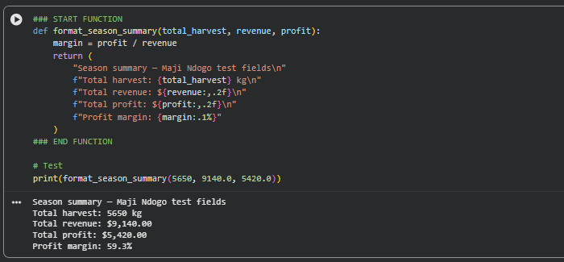
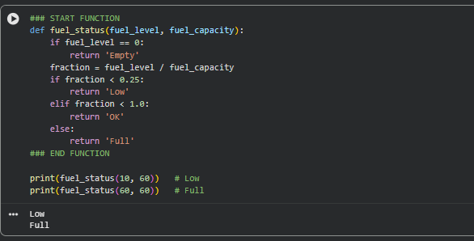
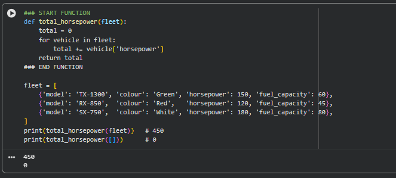

# Building a Digital Twin for Maji Ndogo's Farms

> A Python Foundations case study. The client, the Maji Ndogo Ministry of Agriculture, is fictional and comes from my course scenario. Every output below comes from my own executed code.

---

## 1. The Business Problem

Maji Ndogo has about 5,654 smallholder farms, and its yields vary wildly from field to field with no clear explanation. The Ministry of Agriculture has started using data science to fix this, and I joined as the consultant.

My first task was to turn a notepad of handwritten harvest figures into a clean season record. Two test fields produced 5,650 kg, earned $9,140 and made a $5,420 profit.

The next problem was bigger. The Ministry wants to automate its farms with a **Digital Twin**: a programmable model that mirrors the real land. The tractor parked at the gate didn't know what it had planted, when it needed fuel, or that a rusted irrigation pipe ran along the field's edge. It only moved when someone pushed a button.

My job was to build the logic layer. That's the code that lets the model make decisions, do the repetitive work and remember every farm's harvest.

---

## 2. The Tech Stack

**Core Python only. No libraries.**

| What I used | What it did in this project |
|---|---|
| Conditionals | Read the tractor's fuel gauge; decided whether to start a new farm record or add to an existing one |
| `for` and `while` loops | Counted planted cells across a field grid; drove the tractor along a row until it hit the pipe |
| List and dictionary comprehensions | Flagged machines with small fuel tanks and priced every crop, each in one line |
| Sets | Compared two farms' crop plans to find shared, unique and total crops |
| Lists of dictionaries | Represented the tractor fleet, one record per machine |
| Nested dictionaries | Built a regional registry holding every farm's harvest by crop |

I worked with Python's raw building blocks on purpose. Before I rely on tools that do the work for me, I want to show that I understand the logic those tools are built on.

---

## 3. The Deliverable

### The tractor stops at the pipe
In the field model, `0` is soil, `1` is planted and `-1` is the irrigation pipe. The tractor plants left to right and stops the moment it reaches the pipe. It never plants on it or past it. The row `[0, 1, 0, -1, 0]` becomes `[1, 1, 1, -1, 0]`, so the pipe is protected by the logic itself.

### Dispatch knows which machines have small tanks
From a fleet of three tractors, one line of code returns every model whose fuel capacity is below a set limit. With a limit of 50, only the RX-850 (capacity 45) is flagged, so dispatch can plan refuelling before a long shift rather than after a breakdown.

### A registry that remembers every harvest
Each farm ID holds its own record of crops and kilograms. A new farm gets a fresh record, and a repeat reading adds to the existing total instead of overwriting it. Field 18442's wheat grows from 2,050 kg to 2,550 kg when a further 500 kg comes in, and nothing is lost.

---

## 4. The "So What?"

The Ministry's tractor used to know nothing. Now the Digital Twin protects the irrigation pipe, warns dispatch about machines with small tanks before a shift and keeps a running harvest total for every farm without losing a reading. This is the decision-making layer the Ministry needs before it can automate its fields and start explaining why some farms outperform others.

